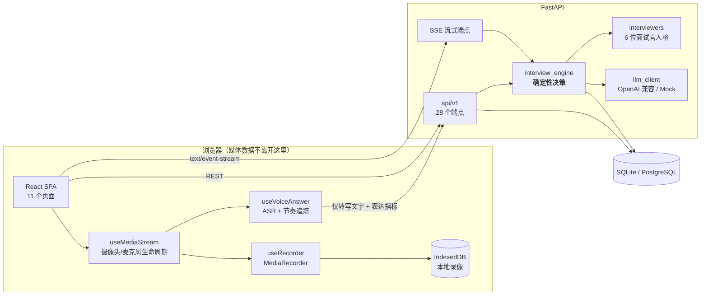

# 秋招 AI 面试陪练平台

面向大学生**秋季校园招聘**的 AI 模拟面试 Web 应用。

**打开摄像头，面对一场会追问的视频面试。** 六位不同风格的面试官轮流提问，
根据你的回答实时追问细节；面试官语音提问，你对着镜头口述作答；
你的语速、口头禅、停顿次数会被实测；结束后拿到五维评分报告、逐题点评，
以及**你自己每一题的录像**。

三件事让它不只是"接了个大模型的聊天框"：

1. **JD 驱动的能力模型** —— 考察点从你的简历和这份 JD 生成，不是随机题库。
2. **自适应追问** —— 追问规则是服务端的**纯函数**（不是提示词里的模糊建议），29 项单测覆盖边界。
3. **可解释评分** —— 每个分数必须**逐字引用你的原话**作为证据，并附改写示范。

---

## 目录

- [两分钟上手](#两分钟上手)
- [视频面试](#视频面试)
- [六位面试官](#六位面试官)
- [两种模式](#两种模式)
- [验证状态](#验证状态)
- [技术栈](#技术栈)
- [架构与数据流](#架构与数据流)
- [核心设计](#核心设计)
- [目录结构](#目录结构)
- [环境变量](#环境变量)
- [测试与验收](#测试与验收)
- [已知限制](#已知限制)
- [合规与隐私](#合规与隐私)
- [设计参考与归属](#设计参考与归属)

---

## 两分钟上手

### 方式 A：一键脚本（Windows / PowerShell）

```powershell
.\dev.ps1 start      # 启动前后端，并等到健康检查通过才算成功
.\dev.ps1 status     # 看端口、健康检查、日志尾部
.\dev.ps1 stop       # 停掉前后端（pid 文件 + 端口双重回收，不留孤儿进程）
.\dev.ps1 restart    # 重启
```

脚本会先检查虚拟环境和 `node_modules` 是否就绪，缺失时直接告诉你要跑哪条命令，
而不是抛一个看不懂的错。日志写到 `logs\`。

> **`.ps1` 文件必须带 UTF-8 BOM**，否则 Windows PowerShell 5.1 在中文系统上会按 GBK 解码，
> 中文注释和字符串会被拆坏并导致语法错误。本仓库的 `dev.ps1` 已经带了 BOM。

### 方式 B：手动两条命令

```bash
# ---------- 后端 ----------
cd backend
python -m venv .venv
# Windows:  .venv\Scripts\activate    macOS/Linux: source .venv/bin/activate
pip install -r requirements.txt
python -m uvicorn app.main:app --reload --port 8000    # 文档 http://localhost:8000/docs

# ---------- 前端（另开终端）----------
cd frontend
npm install
npm run dev                                            # http://localhost:5173
```

### 方式 C：Docker

```bash
cp .env.example .env        # 可选：填 LLM_API_KEY
docker compose up --build   # 前端 8080，后端 8000
```

**不需要任何 API Key**：未配置 `LLM_API_KEY` 时后端自动启用内置 Mock 面试官，
全流程（解析 / 追问 / 评分 / 报告 / 视频指标）都能真跑通。启动日志会打印醒目提示。

> **视频面试需要 `localhost` 或 `https`**。浏览器只在安全上下文里允许访问摄像头 ——
> `http://192.168.x.x:5173` 这种局域网地址会被拒绝，这是浏览器的限制，不是代码问题。
> `dev.ps1` 已经把前端绑到 `localhost`，避免踩这个坑。


---

## 视频面试

这是这个项目与"文字版模拟面试"最大的区别。完整链路：

```
设备检测 → 3-2-1 倒计时 → 面试官语音提问 + 你对着镜头作答
   → 实时转写（可手工修正） → 本地录像 → 结束后逐题回放
```

| 环节 | 做了什么 | 为什么这么做 |
|---|---|---|
| **设备检测** | 摄像头预览、麦克风音量计、设备切换、权限失败的可操作提示 | 真实视频面试平台都有这一步。"面试官都能看到你了，你才发现麦克风没开"是最糟的开场 |
| **坐姿建议** | "镜头与眼睛齐平""看着镜头而不是看着屏幕上的自己" | 这两条是真实视频面试的常见失分点 |
| **3-2-1 倒计时** | 开场仪式感 | 给大脑一个"进入状态"的信号 |
| **面试官语音提问** | 浏览器 TTS 朗读问题，面板同步显示说话波形 | 视频面试里"对面在说话"这件事必须可见 |
| **实时转写** | ASR 流式转写，**结果可以直接编辑** | 识别错误不该由考生背锅 |
| **本地录像** | `MediaRecorder` → 浏览器 IndexedDB，每段回答一个 blob | 见下方「隐私优先」 |
| **表达实测** | 语速（字/分）、口头禅占比、长停顿次数、有效说话时长 | 把"表达流畅"从模型印象变成可核对的数字 |
| **逐题回放** | 报告里可以播放自己的每一段回答 | 很多人第一次看到自己的录像，才发现"我以为我很镇定，其实一直在抖腿" |

**降级路径**（每一层都验证过）：

```
摄像头 + 麦克风 + 语音识别   →  完整视频面试
摄像头不可用                 →  自动切"只录音"，语音面试同样能练表达
浏览器不支持 ASR             →  保留录像，切换为手动输入
完全没有媒体设备             →  纯文字面试（第一轮的完整能力仍在）
```

### 隐私优先：录像不上传服务器

**摄像头与麦克风数据只在你本机处理，服务端只保存一个 key。**

这是一个刻意的取舍：用"换设备看不到录像"换"录像永远不会泄露"。
上传意味着服务器要存、要备份、要能删干净、要防越权下载、还要考虑合规，
而这个功能对用户的价值只是"回看自己"。所以：

- 录像存 `IndexedDB`，只有**语音转写后的文字**会发给服务器用于评分。
- 提供按题删除、按会话清空。
- 报告里如果本机找不到录像，会明确告诉你原因，而不是显示一个坏播放器。

---

## 六位面试官

只有一个面试官的模拟面试，无论提示词写得多好，都会退化成"一个 AI 在问问题"。
真实校招是多轮制的 —— HR 关心动机，技术专家关心原理，主管关心你到底做了什么。

所以六位面试官有名字、有背景、有提问风格、有性格，而且**换人不只是换个名字**：

| 面试官 | 环节 | 关注点 |
|---|---|---|
| 李雯 · 校招 HR | 开场与自我介绍、候选人反问 | 求职动机、岗位理解、稳定性、沟通、自我认知 |
| 陈刚 · 技术主管 | 简历深挖 | 项目真实贡献度、技术决策与取舍、复盘反思 |
| 张明 · 技术专家 | 专业技能 | 计算机基础、技术深度、问题定位、工程实践 |
| 刘芳 · HRBP | 行为面试 | STAR、团队协作、冲突处理、抗压、主动性 |
| 王强 · 系统架构师 | 场景设计 | 方案权衡、容量与性能意识、风险识别 |
| 赵岩 · 终面面试官 | 压力追问 | 抗压表现、数据严谨性、逻辑自洽、诚实度 |

人格会**同时注入提问提示词与评分提示词**：
同一位候选人对 HR 和对技术专家，"好"的定义不一样，评分侧重必须跟着变。
换人时面试官会先自报身份（"我是陈刚，接下来聊聊你的项目部分"），
否则考生会觉得面试官人格分裂。

也支持"单人整场"模式，自己挑一位。

---

## 两种模式

| | 模拟模式（默认，推荐） | 练习模式 |
|---|---|---|
| 面试中的分数 | **全程隐藏** | 每题答完立刻显示评分卡 |
| 适合 | 面试前一周的真实状态演练 | 把某个薄弱点练到能脱口而出 |
| 为什么 | 真实面试你不会知道面试官打几分；知道了就会开始猜评分标准 | 反馈离回答越近，学得越快 |

练习模式的评分卡直接贴在**你自己的那句话下面**：五维得分、被扣分的那句原话、
改写示范、"面试官下一步会追什么"，以及一个可折叠的参考答案。

> 这个区分是刻意的。参考项目 JobPilot 采用"每题即时评分"，
> 在"学"的维度上更优；但本次迭代的目标是"真实模拟面试场景"，
> 所以把两者做成可选，并把视频面试的默认值设为隐藏分数。

---

## 验证状态

本项目**已实际运行并验证**，不是"写完没跑过"的代码。

| 验证项 | 结果 |
|---|---|
| 后端单元 + 集成测试 | **135 项全部通过** |
| 端到端验收（真实 HTTP + SQLite + 真实 SSE 流） | **85/85 项通过** |
| 前后端联调（SPA 外壳 / Vite 编译 / CORS / SSE 跨域） | **5/5 项通过** |
| 代码检查 `ruff check` | **0 问题** |
| 前端类型检查 `tsc --noEmit` | 0 错误 |
| 前端生产构建 `npm run build` | 成功（首屏 gzip ≈ 92 kB，图表库与视频模块按需加载） |
| Docker Compose | 已提供配置，**未在本机执行验证**（本机未安装 Docker） |

一次真实的端到端运行（Mock 面试官，15 分钟面试）：

```
13 轮问答 · 7 次追问 · 覆盖 5 个环节 · 自然结束
五维得分：内容相关性 57 / 结构逻辑 30 / 专业深度 48 / 表达流畅 59 / 岗位匹配 44
13/13 题带「引用原话」的证据；13 题生成改写示范
训练计划 7 天，无「多看书/多练习」这类空话
```

> 分数偏低是因为 E2E 脚本故意混入了空泛回答，用来验证追问规则确实生效。
> **Mock 模式的分数由规则引擎给出，不代表真实模型效果。**

复跑全部验收：

```bash
cd backend
python -m uvicorn app.main:app --port 8000      # 终端 1
python scripts/e2e_check.py                     # 终端 2：85 项端到端
python scripts/check_integration.py             # 终端 3：5 项联调（需前端 dev server）
python scripts/db_summary.py                    # 查看演示数据概况
```

三个脚本都以**退出码**表示结果（0 = 全部通过），可直接接进 CI。

### 已有演示数据

跑过 `e2e_check.py` 后 `backend/dev.db` 里会留下十几场完整记录
（含文字面试与视频面试、63 轮问答、6 份报告）。想直接看效果可以登录：

```
邮箱：e2e_1792055093@example.com
密码：secret123
```

> 想看自己账号下的数据就重新跑一次 `e2e_check.py`，
> 然后用 `python scripts/db_summary.py` 打印出的最新邮箱登录。
> 想从零开始就删掉 `backend/dev.db` 重启服务（会自动重建表）。

---

## 技术栈

| 层 | 选型 | 版本（实测通过） |
|---|---|---|
| 前端 | React + TypeScript + Vite | 18.3 / 5.7 / 5.4 |
| 样式 | TailwindCSS（手写 shadcn 风格原语，不依赖 CLI） | 3.4 |
| 状态 | Zustand（会话/主题）+ TanStack Query v5（服务端状态） | 4.5 / 5.62 |
| 图表 | Recharts（雷达图 + 趋势线） | 2.15 |
| **媒体** | **原生 MediaDevices + MediaRecorder + Web Speech API + IndexedDB**（零依赖） | — |
| 后端 | FastAPI + Uvicorn + SSE-Starlette | 0.143 / 0.54 / 3.5 |
| 数据 | SQLModel + SQLAlchemy(async) + aiosqlite | 0.0.48 / 2.1 / 0.22 |
| 认证 | PyJWT + bcrypt（**不用 passlib**，见下） | 2.15 / 5.0 |
| LLM | openai SDK（OpenAI 兼容协议） | 3.31 |
| 解析 | pypdf + python-docx（pdfplumber 可选） | 6.20 / 1.2 |
| 测试 | pytest + pytest-asyncio | 9.1 / 1.4 |

**媒体能力为什么不用库**：`getUserMedia` / `MediaRecorder` / `SpeechRecognition` / `IndexedDB`
都是浏览器原生 API。引入 `recordrtc`、`react-media-recorder` 这类封装只会增加体积和黑盒，
而我们需要对生命周期（权限、设备切换、track 释放、录制时间轴对齐）有完全控制。

**为什么不用 passlib**：passlib 1.7.4 与 bcrypt ≥ 4.1 存在
`AttributeError: module 'bcrypt' has no attribute '__about__'` 兼容性缺陷，会在启动时直接报错。

**为什么依赖写 `>=` 而不是 `==`**：本机是 Python 3.14，只有满足下限的最新版才有对应 wheel。

---

## 架构与数据流



一次视频面试的业务流：

```
简历 PDF/DOCX ─► 结构化解析 ─┐
                            ├─► 匹配分析（评分 + 优势 + 风险 + Top5 预判问题）
JD 文本 ─► 能力模型 + 权重 ─┘
                            └─► 面试计划（6 环节 + 考察点）+ 面试官分配表
                                      │
                        ┌─────────────┘
                        ▼
   设备检测 ─► 倒计时 ─► 每轮：
       面试官 TTS 语音提问（人格决定提问口径）
       → 你口述，ASR 实时转写 + MediaRecorder 录像 + 节奏追踪
       → [并发] 五维评分（独立调用；语速/口头禅/停顿作为客观依据）
       → 确定性引擎决定「追问 or 换考察点 or 收尾」
                        │
                   时间/环节耗尽
                        ▼
              报告：雷达图 · 表达实测 · 逐题点评（原话证据）· 录像回放 · 7 天计划
```

详细设计（时序图、ER 图、故障处理矩阵、成本优化）见 **[docs/architecture.md](docs/architecture.md)**。

---

## 核心设计

### 1. 决策与措辞分离（本项目最重要的决定）

最初让 LLM 直接输出 `{say, question, is_followup, competency, stage_finished}` 的 JSON，立刻暴露三个问题：

| 问题 | 后果 |
|---|---|
| JSON 无法边生成边用 | 流式打字机退化成"等 3 秒然后一次性出现" |
| 追问交给模型判断 | 会连续追问五六层，30 分钟耗在第一个项目上 |
| 逻辑不可测试 | 无法为模型的随机行为写断言 |

最终拆成两半：

| 职责 | 实现 | 可测试 |
|---|---|---|
| 这一轮该追问还是换考察点 | `services/interview_engine.py::decide_next()` **纯函数** | ✅ 29 项单测 |
| 用哪句话说出来 | LLM 流式输出**纯文本**（注入面试官人格） | 最坏只是"话说得不自然" |

### 2. 三条追问规则（可判定、可断言）

```python
回答里有具体数字 / 技术名词      →  追来源与做法（怎么测的？基线是什么？）
回答空泛（"参与了""做了一些"）   →  追具体案例（举一个实际例子，你改了什么？）
压力环节 或 有数字+对比的强主张   →  温和质疑（什么条件下不成立？边界怎么处理？）
```

外加两条硬约束：**同一考察点最多追 2 层**；**剩余时间 < 20% 停止追问，< 5% 直接收尾**。

### 3. 五维评分 Rubric

| 维度 | 权重 | 锚点 |
|---|---|---|
| `relevance` 内容相关性 | 20% | 是否正面回答、是否答非所问 |
| `structure` 结构逻辑 | 20% | 是否 STAR / 分层清晰 |
| `depth` 专业深度 | 25% | 技术细节、数据、权衡取舍 |
| `delivery` 表达流畅 | 15% | **语音作答时有实测数字为准**：语速 180-320 字/分、口头禅 <2%、长停顿 ≤3 次 |
| `fit` 岗位匹配 | 20% | 是否体现岗位所需能力与业务理解 |

**出题与评分是两次独立调用**（不同角色、不同 temperature、可用不同模型），
避免"自己出题自己打高分"；评分**强制引用候选人原话**作为证据；
并把**面试官实际追问的内容**也传给评分器，让分数反映真实交锋。

提示词设计细节见 **[docs/prompt-design.md](docs/prompt-design.md)**。
第二轮从参考项目学到的设计见 **[docs/iteration-from-jobpilot.md](docs/iteration-from-jobpilot.md)**。

### 4. 面试进行页刻意不显示分数（模拟模式下）

这是产品决策：看到分数会让人分心去猜评分标准，破坏沉浸感。
评分仍在每轮后台完成并落库，只在报告里呈现。`feedback_mode: "practice"` 可切换到每题即时评分。

---

## 目录结构

```
.
├── docker-compose.yml  .env.example
├── backend/
│   ├── Dockerfile  requirements.txt  pyproject.toml  .env.example
│   ├── scripts/
│   │   ├── e2e_check.py            # 端到端验收（85 项）
│   │   ├── check_integration.py    # 前后端联调（5 项）
│   │   └── db_summary.py           # 演示数据概况
│   └── app/
│       ├── main.py                 # 入口 · 统一异常处理 · CORS
│       ├── constants.py            # 环节/维度/意图/追问规则/表达阈值
│       ├── interviewers.py         ★ 6 位面试官人格（中英双语）
│       ├── core/                   # config · db · security · deps · errors · logging
│       ├── models/                 # SQLModel 表（不用 Relationship）
│       ├── schemas/                # DTO + LLM 输出 schema（含脏数据归一化）
│       ├── api/v1/                 # auth · resumes · jds · match · interviews · stats
│       ├── services/
│       │   ├── interview_engine.py   ★ 确定性决策层（纯函数）
│       │   ├── interview_service.py  ★ 状态机 · 并发评分 · 断流兜底 · 提示/跳过/暂停
│       │   ├── prompts.py            ★ 全部提示词
│       │   ├── llm_client.py         传输层（超时/重试/JSON 修复/用量统计）
│       │   ├── ai_service.py         真实实现
│       │   ├── mock_ai.py            规则引擎（无 Key 时）
│       │   ├── resume_parser.py      PDF/DOCX 解析
│       │   └── factory.py            服务工厂（可注入替身）
│       └── tests/                    # 135 项测试
├── frontend/
│   ├── Dockerfile  nginx.conf  package.json  vite.config.ts  tailwind.config.js
│   └── src/
│       ├── api/                    # client（统一错误）· sse（手写分帧）· endpoints · types
│       ├── stores/                 # auth · interviewRoom · theme
│       ├── hooks/
│       │   ├── useMediaStream.ts     ★ 摄像头/麦克风生命周期 + 音量计
│       │   ├── useRecorder.ts        ★ MediaRecorder 封装
│       │   ├── useVoiceAnswer.ts     ★ ASR + 录像 + 节奏追踪对齐
│       │   ├── useInterviewStream.ts   SSE 编排
│       │   └── useCountdown.ts  useSpeech.ts
│       ├── lib/
│       │   ├── videoStore.ts         ★ 录像本地存储（IndexedDB）
│       │   ├── deliveryMetrics.ts    ★ 语速/口头禅/停顿计算
│       │   ├── constants.ts  utils.ts  token.ts
│       ├── components/
│       │   ├── interview/          DeviceCheck · SelfView · InterviewerPanel
│       │   │                       AnswerFeedbackCard · AnswerPlayback · StageRail
│       │   ├── ui/                 button · card · form · feedback · modal · tabs · toast
│       │   ├── charts/  layout/  Markdown.tsx  ErrorBoundary.tsx
│       └── pages/                  # 11 个页面
└── docs/
    ├── architecture.md             # 时序图 · ER 图 · 决策理由 · 故障矩阵
    ├── prompt-design.md            # 提示词为什么这么写
    ├── iteration-from-jobpilot.md  # 第二轮迭代：学到什么、刻意不做什么
    └── demo-script.md              # 3 分钟演示脚本 + 备答
```

---

## 环境变量

后端（`backend/.env`，经 `pydantic-settings` 读取，**代码中无硬编码密钥**）：

| 变量 | 默认 | 说明 |
|---|---|---|
| `SECRET_KEY` | 占位值 | 生产环境必须替换，否则启动直接报错 |
| `DATABASE_URL` | `sqlite+aiosqlite:///./dev.db` | 生产可换 `postgresql+asyncpg://...` |
| `LLM_API_KEY` | 空 | **留空 → 自动启用 Mock 面试官** |
| `LLM_BASE_URL` | DeepSeek | 任意 OpenAI 兼容端点 |
| `LLM_MODEL` / `LLM_MODEL_EVAL` | `deepseek-chat` | 后者留空则复用前者 |
| `LLM_TIMEOUT_SECONDS` / `LLM_MAX_RETRIES` | 60 / 2 | 超时与重试 |
| `UPLOAD_MAX_MB` | 5 | 简历文件大小上限 |
| `CORS_ORIGINS` | `localhost:5173` | 逗号分隔 |
| `LOG_LEVEL` | `INFO` | 日志级别 |

前端：`VITE_API_BASE_URL`（默认 `http://localhost:8000/api/v1`）。

---

## 测试与验收

```bash
cd backend
pytest -v                       # 135 项单元 + 集成测试
ruff check app scripts          # 代码检查

# 以下需要服务已启动
python scripts/e2e_check.py         # 85 项端到端（真实 HTTP + SSE）
python scripts/check_integration.py # 5 项前后端联调
python scripts/db_summary.py        # 演示数据概况

cd ../frontend
npm run typecheck               # tsc --noEmit
npm run build                   # 生产构建
```

测试重点覆盖：

- **面试引擎**：首轮开场、三条追问规则、2 层上限、开场/反问环节不追问、时间耗尽强制收尾、
  环节顺序推进、考察点池按环节隔离、跑完一整场能自然进入反问
- **面试官人格**：6 位 × 中英双语、人格字段完整、多轮模式 ≥4 位不同面试官、
  单人模式全员一致、逐题带面试官信息
- **视频面试**：表达指标落库与非法值拒绝、纯文字时汇总标记为 `is_voice: false`（不报"语速 0"）、
  报告含表达汇总与逐题回放 key
- **真实面试行为**：提示只给结构不给答案、提示只增不减、跳过记 0 分并推进、
  标记开关、参考答案占位符纪律与幂等缓存、暂停期间拒绝答题、暂停时长被扣除
- **Schema 健壮性**：`"4分"` / 85（百分制）/ 8（十分制）/ 嵌套对象 / 无法解析 → 归一化到 1-5；
  JSON 围栏与尾随逗号修复；Top 问题硬限制 ≤ 3
- **API 全链路**：注册→登录→传简历→建 JD→匹配（含缓存）→面试→SSE→评分→报告
- **健壮性**：损坏 PDF 明确报错、空文件、不支持的类型、越权访问返回 404、
  非法登录不区分账号是否存在、已被面试引用的简历禁止删除、已结束会话拒绝应答

---

## 已知限制

1. **评分一致性未做人工标注集校准。** 这是最该补的实验：取 20 份真实问答人工按同一 rubric 打分，
   计算与 AI 打分的相关性，并统计各维度的系统性偏差。当前所有防偏置手段都是"设计上应该有效"。
2. **语音识别依赖浏览器 Web Speech API**，Chrome / Edge 之外不可用（已自动降级为手动输入 +
   保留录像）。服务端 ASR（Whisper）未接入。
3. **录像换设备就看不到** —— 这是"录像不上传服务器"的代价，已在报告里明确说明。
4. **简历解析依赖 PDF 文本层**，扫描件 / 纯图片 PDF 无法处理（已明确报错，不是静默返回空）。
5. **表达指标是启发式的**：语速按词数/时长估算，长停顿按 ASR 结果间隔估算，
   不是声学级分析。它能抓住"说得太慢/口头禅太多/卡壳明显"，但读不出情绪与音色。
6. **面试计划质量取决于 JD 质量**，JD 太笼统时考察点也会泛。
7. **未做并发压测**：SSE 长连接 + 单进程 uvicorn 的承载上限没有实测数据。
8. **Mock 模式的分数由规则引擎给出**，用于打通流程与测试，不代表真实模型效果。

---

## 合规与隐私

- 面试官**不询问、不推断**年龄、性别、婚育、籍贯、民族、宗教、健康、家庭背景、外貌、口音；
  简历中若含此类信息一律忽略。
- 评分维度中**根本不存在**形象、气质这类项（结构上排除，而非靠提示词劝阻）；
  口音相关问题只以中性的"表达清晰度"衡量，且只依据语速/停顿等客观指标。
- 改写示范与参考答案**只能基于学生真实说过的内容**；缺少事实时保留
  `[补充具体指标]` 这类占位符，**绝不猜测** —— 编造漂亮的假数据等于教学生编简历。
- **摄像头与麦克风数据只在本机处理，录像不上传服务器**；只有语音转写后的文字会发给服务器评分。
- 日志对简历原文脱敏（手机号 / 邮箱 / 身份证打码，全文只记长度）。
- 越权访问统一返回 404，不泄露资源是否存在。

## 后续规划

- [ ] **评分一致性评估**（20 份人工标注集，算相关系数）—— 优先级最高
- [ ] 服务端 ASR（Whisper）替代浏览器识别，覆盖 Safari / Firefox
- [ ] 面部/姿态的客观指标（眼神是否看镜头、坐姿稳定性）—— 需要本地推理，不能上传
- [ ] 题库沉淀与面经检索
- [ ] 错题本 / 15 分钟专项复练
- [ ] 全英文面试模式 + 发音用词维度
- [ ] 并发压测与 SSE 承载上限评估

---

## 设计参考与归属

面试官人格库、单题即时评分卡、回合状态机（提示/跳过/标记）、
参考答案的"占位符纪律"、以及"反 AI 腔"护栏，设计思路参考了
[**jlifeng/JobPilot**](https://github.com/jlifeng/JobPilot)（Apache-2.0 许可）。

- **没有复制任何代码**：人格文案按大学生秋招场景重写（中文优先），数据流与评分链路重新设计。
- JobPilot 的面试是**纯文字**的，没有任何音视频能力；视频面试链路（设备检测、录像、
  实时转写、表达指标、本地存储、逐题回放）是本项目独立实现的。
- 详细的"采纳/不采纳/做得不一样"对照见
  **[docs/iteration-from-jobpilot.md](docs/iteration-from-jobpilot.md)**。
