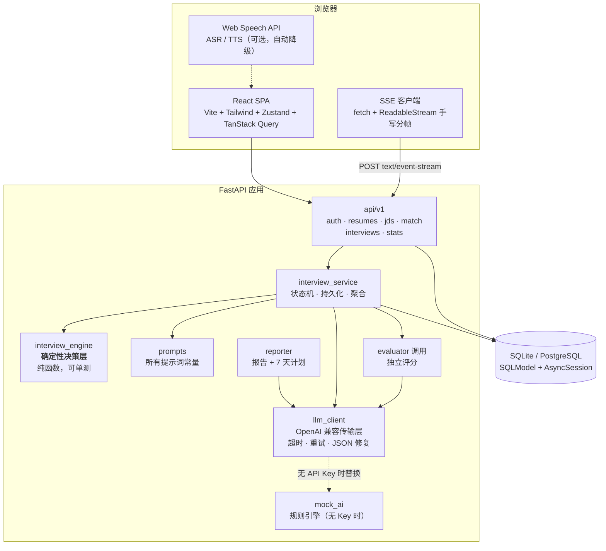
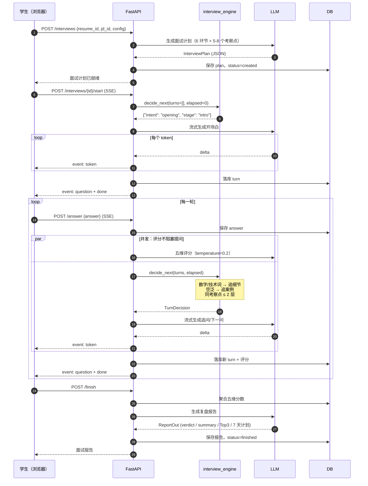
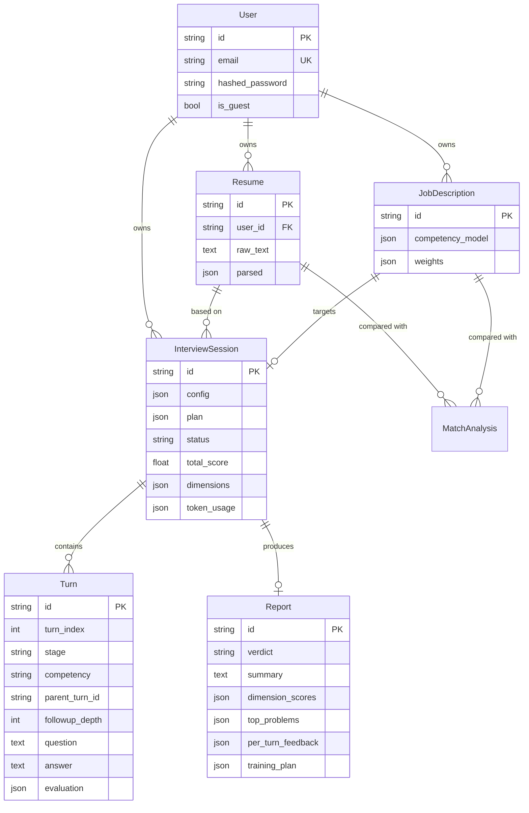

# 架构说明

> 面向读者：想快速理解这个项目"为什么这么设计"的人（包括面试官和未来的自己）。

## 1. 整体结构



## 2. 一次面试的完整时序



## 3. 数据模型



**为什么不用 SQLModel `Relationship`**：异步会话下惰性加载会抛 `MissingGreenlet`。
全部改为显式 `select()`，代价是多写几行查询，收益是行为可预测、无 N+1 意外、
也没有循环导入。列表接口的简历名 / JD 标题 / 轮次数都用批量查询一次取回。

## 4. 关键设计决策

### 4.1 决策与措辞分离（本项目最重要的一个决定）

最初的设计是让 LLM 一次性返回 `{say, question, is_followup, competency, stage_finished}` 的 JSON。
实现时发现三个问题：

1. **无法真正流式** —— JSON 必须等整段生成完才能解析，前端的打字机效果就变成了假的；
2. **追问不可控** —— 模型会连续追问五六层，30 分钟面试耗在第一个项目上；
3. **追问逻辑无法测试** —— 你没法为"模型随机行为"写断言。

最终改为：

| 职责 | 由谁负责 | 可测试性 |
|---|---|---|
| 这一轮该追问还是换考察点 | `interview_engine.decide_next()`（纯函数） | ✅ pytest 直接断言 |
| 用哪句话说出来 | LLM（流式纯文本） | 无需测试，最坏情况只是"话说得不自然" |

`advance_turn` 产出 `("token", 文本)` 事件流，SSE 端点直接转发，用户看到的是**真实流式输出**。

### 4.2 出题与评分必须是两次独立调用

让出题人给自己出的题打分，会系统性抬高分数——模型倾向于认为自己问的问题得到了合理回答。
所以 `evaluator` 是独立提示词、独立角色（"你不是出题人"）、`temperature=0.2`、
且可以使用更便宜的模型（`LLM_MODEL_EVAL`）。

### 4.3 评分必须强制引用证据

`Evaluation.evidence` 要求逐字引用候选人原话。这不是为了好看：
没有证据的分数无法被用户信任，也无法用于自查。Mock 实现同样遵守这条规则
（从回答里按句切分取前几句）。

### 4.4 结构化输出必须能容错

模型返回脏数据是常态。`schemas/llm.py` 里做了三层防御：

| 脏数据 | 处理 |
|---|---|
| `"4分"` / `4.5/5` / `85`（百分制）/ `8`（十分制） | `_normalize_score()` 统一归一到 1-5 |
| 嵌套对象 `{"score": 4}` | `field_validator(mode="before")` 打平 |
| 漏字段 | 全部给默认值，不让整场面试崩 |
| ```` ```json ```` 围栏 / 前后寒暄 / 尾随逗号 | `extract_json()` 逐级降级解析 |
| 反复校验失败 | 把 Pydantic 错误回传给模型做一次修复重试 |

### 4.5 上下文压缩

一场 45 分钟面试约 23 轮问答。全量上下文会让 token 消耗线性膨胀。
`prompts.render_transcript()` 的策略：**最近 4 轮保留全文，更早的轮次压缩成一行摘要**。

同时每场会话都累计 `token_usage`（含按任务的分解），暴露在 `GET /interviews/{id}` 里，
让"这个功能烧多少钱"变成可观测的数字。

### 4.6 断流不丢数据

SSE 客户端断开时，`advance_turn` 的 `finally` 块仍然执行，把**已生成的那部分问题落库**。
若评分任务还没完成，它会被移交到后台任务，用**独立的数据库会话**写入
（原请求的会话此时可能已关闭）。这是 `_persist_evaluation` 存在的原因。

前端对应地有一个恢复路径：如果"上一题已作答但下一题未生成"，
`POST /interviews/{id}/next` 可以在不携带回答的情况下继续推进。

### 4.7 面试进行页不显示分数

这是产品决策，不是技术限制：看到分数会让人分心去猜测评分标准，破坏沉浸感。
评分仍在每轮后台完成并落库，只在报告里呈现。配置项 `realtime_feedback` 可开启实时展示。

### 4.8 视频面试：媒体生命周期与隐私取舍

这是第二轮迭代新增的部分，也是与参考项目 JobPilot（纯文字面试）最大的差异。

**为什么不用封装库**。`getUserMedia` / `MediaRecorder` / `SpeechRecognition` / `IndexedDB`
都是浏览器原生 API。`recordrtc`、`react-media-recorder` 这类封装能省几十行，
但会让我们失去对三件关键事情的控制：

1. **track 释放时机** —— 组件卸载没释放，摄像头指示灯会一直亮着，用户会以为被偷拍；
2. **设备切换** —— 需要在保留权限的前提下只换 track，而不是重新走一遍授权；
3. **ASR 与录制的时间轴对齐** —— 算语速必须知道"这段文字对应录音的哪一段"，
   两者开始/结束如果差几百毫秒，语速就是错的。

所以媒体层是三个自研 hook，职责边界清晰：

| Hook | 负责 | 关键点 |
|---|---|---|
| `useMediaStream` | 权限申请 → 设备枚举 → 预览 → 音量计 → 释放 | 拿到权限后必须**重新枚举设备**（此前 `label` 为空）；卸载时 stop 所有 track |
| `useRecorder` | 一段回答的 `MediaRecorder` 生命周期 | 按优先级挑容器（vp9/opus → vp8 → webm → mp4）；`start(1000)` 分片落盘，避免长回答堆内存 |
| `useVoiceAnswer` | 把 ASR + 录制 + 节奏追踪**对齐**成一次作答 | `begin()` 三者同时启动，`end()` 先停 ASR 再停录制，用**录制时长**作为语速分母 |

**降级链路**（每一层都有对应实现，不是写在文档里的承诺）：

```
摄像头 + 麦克风 + ASR  →  完整视频面试
摄像头不可用           →  getUserMedia 抛错后自动重试 {audio:true, video:false}，UI 明确提示"已切只录音"
浏览器不支持 ASR       →  保留录像，输入区切为手打
完全没有媒体设备       →  纯文字面试（第一轮能力完整保留）
非安全上下文(http)     →  检测 window.isSecureContext，直接说明需要 localhost 或 https
```

**隐私取舍：录像不上传服务器。**

```
浏览器                                   服务器
┌──────────────────────┐                ┌────────────────────┐
│ MediaRecorder → Blob │                │ turns.recording_key│  ← 只存一个 key
│ IndexedDB: 录像本体   │  ── 仅转写文字 ─→│ turns.answer       │
│                      │      + 表达指标  │ turns.delivery_metrics│
└──────────────────────┘                └────────────────────┘
```

代价与收益都明确：
- **收益**：录像永远不会泄露；不需要为视频做存储、备份、级联删除、越权下载防护与合规评估。
- **代价**：换设备 / 换浏览器 / 清理浏览器数据后录像不可回放。
  这一点在报告中**明确告知用户**（`AnswerPlayback` 里有一条专门的说明），而不是显示一个坏播放器。

**表达指标如何进入评分。** 这是把"表达流畅"从主观印象变成可核对数字的关键：

```
前端（客观实测）                          后端（写进口径）
语速 = 词数 / 录制时长(分)  ──┐
口头禅占比 = 口头禅字数/总字数 ├─→ Evaluation.delivery 的评分依据
长停顿 = ASR 结果间隔 > 2.5s ─┘   语速 <180 或 >320 → 最高 3.5
                                  口头禅 >6%       → 最高 3.0
                                  长停顿 >3 次     → 最高 3.0
                                  纯文字作答        → 明确告知"没有数据，不要臆测"
```

最后一条与其余同样重要：**没有数据时明确说没有数据**，而不是让模型编一个语速出来。

### 4.9 多轮换人：人格影响提问也影响评分

`interviewers.py` 里 6 位面试官不只注入**提问**提示词，也注入**评分**提示词。
原因是：同一位候选人对 HR 和对技术专家，"好"的定义不同 ——
HR 看重动机与表达，技术专家看重原理与边界。只换提问口径、评分不变，
会出现"王强（架构师）在问方案权衡，评分却在看你有没有讲求职动机"的错位。

人格注入刻意**只做一件事**：`build_question_system(persona)` / `build_evaluator_system(persona)`
在基础系统提示词后追加一段人格描述，并明确写"人格只改变五维分数的侧重，
不改变评分维度本身，也不改变锚点标准"。避免模型因为"我是 HR"就把技术分打高。

另外，`decide_next()` 决定的是**环节**，`roster[stage]` 才决定**谁来问** ——
两者解耦意味着换面试官不会影响面试结构，仍然可以单测。


| 故障 | 表现 | 处理 |
|---|---|---|
| LLM 超时 / 连接失败 / 429 | 上游不可用 | 指数退避重试 2 次；仍失败则 SSE 下发 `error` 事件 + 前端"重试"按钮 |
| 上游不支持 `response_format` | 400 | 自动降级为纯文本模式重试一次 |
| LLM 输出非法 JSON | 校验失败 | 修复重试；仍失败抛 `LLMError` |
| 单题评分失败 | 拿不到分数 | 降级为中性分 3.0，主流程继续（评分是旁路） |
| 报告生成失败 | 拿不到复盘 | 本地汇总兜底，逐题点评仍然可见 |
| 上传纯图片 PDF | 提取不到文字 | 明确报错"请上传文字版简历"，不是静默返回空 |
| 上传损坏 PDF | 解析异常 | 转成 `DOCUMENT_PARSE_FAILED`，不抛 500 |
| SSE 中途断网 | 连接中断 | 前端保留已答内容 + 提供继续/重试；服务端落库已生成内容 |
| 访问他人面试 | 越权 | 统一返回 404（不区分"不存在"与"无权限"，避免探测） |
| 已结束会话继续答题 | 状态冲突 | 409 `INTERVIEW_STATE_INVALID` |

### 5.1 视频面试特有的故障

媒体设备的失败模式比网络多得多，每一种都必须在面试开始前就被拦住（放进"设备检测"步骤），
而不是等到面试中途才发现。

| 故障 | 表现 | 处理 |
|---|---|---|
| 权限被拒（`NotAllowedError`） | 摄像头打不开 | 给出**可操作**提示："点击地址栏锁形图标 → 允许摄像头与麦克风 → 刷新页面"，而不是"出错了" |
| 无设备（`NotFoundError`） | 没有摄像头/麦克风 | 视频轨不可用时自动降级为 `{audio: true}`，UI 明确标注"只录音模式" |
| 设备被占用（`NotReadableError`） | 开着腾讯会议/OBS | 明确提示"设备被其他程序占用，请关闭后重试"（这是最常见也最容易被误判为 bug 的情况） |
| 非安全上下文（`SecurityError`） | 用局域网 IP 访问 | 在 `useMediaStream` 里直接检测 `isSecureContext`，提示需要 `localhost` 或 `https` |
| 浏览器不支持 ASR | `SpeechRecognition` 未定义 | 保留录像，输入区切换为手打，并明确提示改用 Chrome/Edge |
| 浏览器不支持录制 | `MediaRecorder` 未定义 | 保留 ASR 与指标，仅不保存录像 |
| 录制中途出错 | `MediaRecorder.onerror` | 保留已收到的分片，提示"这一段可能无法回放"，但不影响作答提交 |
| 录像写入失败 | IndexedDB 配额满 / 隐私模式禁用 | 作答照常提交，toast 提示"录像未能保存到本机" |
| 本机找不到录像 | 换设备 / 清过数据 | 报告里给出**原因说明**，而不是坏播放器 |
| 用户中途拔掉设备 | `devicechange` 事件 | 监听并刷新设备列表 |
| 组件卸载未释放 | 摄像头指示灯常亮 | `useMediaStream` 的 cleanup 里 stop 所有 track（这是隐私问题，不是小 bug） |


## 6. 成本与性能

| 项 | 优化 |
|---|---|
| 匹配分析 | 同一 `resume_id + jd_id` 命中缓存直接返回（实测 26ms → 14ms） |
| 面试计划 | 只在创建会话时生成一次 |
| 对话上下文 | 近 4 轮全文 + 更早轮次摘要 |
| 评分模型 | 可单独配 `LLM_MODEL_EVAL` 用更便宜的模型 |
| token 用量 | 按任务分解落库，可观测 |
| 前端首屏 | 非首页路由全部 `React.lazy`；recharts（412 kB）只在报告/趋势页加载；vendor 分包 |

## 7. 已知限制

1. **评分一致性未做人工标注集校准**。当前靠固定锚点 + 强制证据缓解，但没有量化
   "AI 打分与人工打分的相关性"。这是最该补的实验。
2. **简历解析依赖 PDF 文本层**，扫描件无法处理（已明确报错而非静默失败）。
3. **语音仅走浏览器原生 API**，Chrome / Edge 之外自动降级为文字；服务端 ASR 未接入。
4. **面试计划质量取决于 JD 质量**，JD 写得太笼统时考察点也会泛。
5. **未做并发压测**：SSE 长连接 + 单进程 uvicorn 的承载上限没有实测数据。
